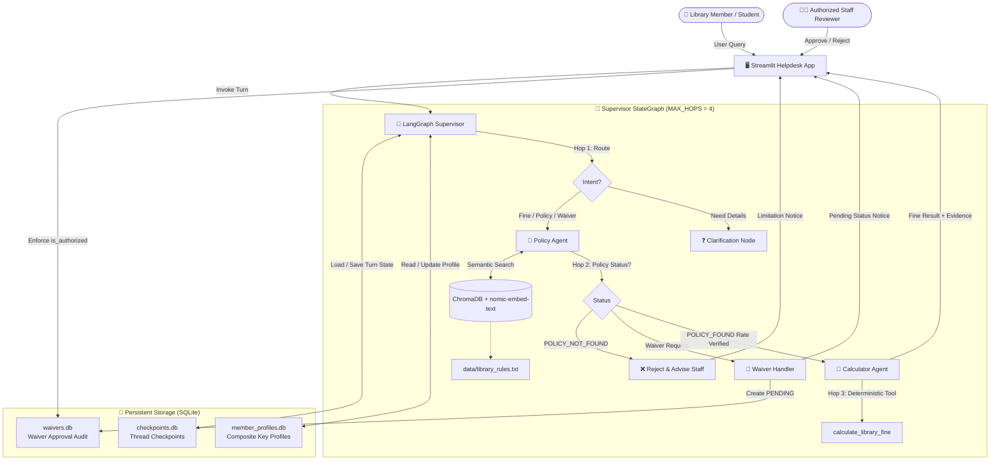

# Library Fine Calculator Agent — Unit 3 & Unit 4 Architecture
**College Second Review Upgrade: Autonomous Multi-Agent Library Helpdesk**

[](https://python.org)
[](https://langchain.com)
[](https://ollama.ai)
[](https://chromadb.com)
[](https://streamlit.io)

---

## 1. Project Overview & Objectives

This project upgrades the baseline Library Fine Calculator into an enterprise-grade, locally running, multi-agent AI system for academic library management. All LLM inference and embeddings run **100% locally** via **Ollama** (`qwen2.5:3b` and `nomic-embed-text`), requiring **zero paid hosted API keys**.

### Key Deliverables Implemented:
- **Unit 3A: Thread Memory** — LangGraph SQLite Checkpointing (`data/checkpoints.db`) preserving conversation context across follow-up queries (e.g., *"And if it were a reference book?"*).
- **Unit 3B: Member Profile Storage** — SQLite persistent table with composite primary key `(member_id, namespace='profile')` using parameterized SQL and lossless JSON updates.
- **Unit 3C: Local RAG Policy Engine** — Semantic search over `data/library_rules.txt` using ChromaDB and `nomic-embed-text` with explicit relevance validation and `POLICY_NOT_FOUND` rejection.
- **Unit 4: LangGraph Supervisor with MAX_HOPS** — Explicit StateGraph routing between specialized **Policy Agent** and **Calculator Agent**, with bounded loop protection (`MAX_HOPS = 4`).
- **Human-in-the-Loop Waiver Workflow** — Persistent waiver queue in SQLite (`data/waivers.db`) enforcing server-side authorized staff approval/rejection and decision immutability.
- **Pre-Due Date Fine Reminder Engine** — Proactive notification system backed by `data/loans.db` that alerts borrowers before their return deadline (2 days / 1 day / due today) warning of impending daily fines (Novel: ₹5/day, Textbook: ₹10/day, Reference: ₹15/day) to prevent fine accumulation.


---

## 2. System Architecture



---

## 3. Directory Structure

```text
library-fine-agent/
├── app.py                     # Enhanced Streamlit Helpdesk Dashboard
├── library_fine_agent.py      # Core agent facade & CLI test suite
├── requirements.txt           # Project dependencies
├── README.md                  # Comprehensive documentation & review guide
├── data/
│   ├── library_rules.txt      # One-page sample policy document
│   ├── member_profiles.db     # SQLite store for (member_id, namespace)
│   ├── checkpoints.db         # LangGraph SQLite thread checkpoints
│   ├── waivers.db             # Human-in-the-loop waiver requests
│   └── chroma_db/             # Local Chroma vector database
├── memory/
│   ├── __init__.py
│   └── sqlite_memory.py       # MemberProfileStore & Checkpointer factory
├── rag/
│   ├── __init__.py
│   └── rag_engine.py          # ChromaDB + nomic-embed-text RAG pipeline
├── agents/
│   ├── __init__.py
│   ├── policy_agent.py        # Policy retrieval agent (never calculates)
│   ├── calculator_agent.py    # Deterministic arithmetic agent (never invents rates)
│   └── supervisor.py          # LangGraph supervisor workflow & routing
├── approvals/
│   ├── __init__.py
│   └── waiver_approval.py     # Staff waiver authorization & audit log
├── traces/
│   └── supervisor_trace.txt   # Actual execution traces from test cases
└── tests/
    ├── __init__.py
    ├── test_fine_tool.py      # Arithmetic, zero days, negative days, overrides
    ├── test_memory.py         # Thread memory, context reuse, profile persistence
    ├── test_rag.py            # Vector search, rates, POLICY_NOT_FOUND
    └── test_supervisor.py     # Full 5 review cases, MAX_HOPS, waiver audit
```

---

## 4. Installation & Setup

### Prerequisites
1. **Python 3.11+** installed.
2. **Ollama** installed and running locally on port 11434.

### Step 1: Pull Required Local Ollama Models
```powershell
ollama pull qwen2.5:3b
ollama pull nomic-embed-text
```

### Step 2: Install Python Dependencies
```powershell
# In the project root:
.\venv\Scripts\Activate.ps1
pip install -r requirements.txt
```

### Step 3: Run Automated Test Suite (25 Tests)
```powershell
python -m unittest discover -s tests -v
```
*Expected: 25 tests pass with `OK`.*

---

## 5. Running the Project

### Option A: Launch Interactive Streamlit Helpdesk (Recommended)
```powershell
.\venv\Scripts\streamlit.exe run app.py
```
Open **`http://localhost:8501`** in your browser. The dashboard includes:
1. **Helpdesk Assistant Tab:** Interactive chat, conversation history, policy evidence expander, and hop-by-hop supervisor routing trace.
2. **Fine Waiver Portal Tab:** Student submission form, staff reviewer authorization toggle, approve/reject controls, and immutable audit log.
3. **Member Profile Tab:** View and update member records backed by SQLite composite keys `(member_id, 'profile')`.
4. **Library Rules & RAG Tab:** Live semantic search query tester against ChromaDB.

### Option B: Run Standalone CLI Trace Generator
```powershell
python library_fine_agent.py
```
Executes all 5 college review test cases sequentially and prints full hop-by-hop agent traces to the terminal.

---

## 6. TA1 (Baseline) vs. TA2 (Upgraded) Evaluation Table

*Results below are taken directly from actual execution runs in `tests/test_supervisor.py` and `traces/supervisor_trace.txt`.*

| Evaluation Case | Test Query / Scenario | TA1 (Baseline Agent) | TA2 (Upgraded Multi-Agent System) | College Review Verification |
|---|---|---|---|---|
| **Case 1: Normal Fine Calculation** | *"A novel was returned 5 days late. How much is the library fine?"* | Hardcoded daily rate inside Python tool; no policy verification or grounding. | **Policy Agent** verifies ₹5/day from `data/library_rules.txt` via Chroma RAG; **Calculator Agent** computes ₹25; outputs exact policy source citation. | ✅ **Passed**<br>(Hop count: 3) |
| **Case 2: Thread Memory Follow-up** | Turn 1: *"My novel is 5 days overdue."*<br>Turn 2: *"And if it were a reference book?"* | **Failed:** Stateless; Turn 2 immediately forgot the 5 days overdue context and halted or guessed. | **Passed:** LangGraph SQLite Checkpointer resolves `overdue_days=5` from thread history; retrieves reference rate (₹15/day); outputs ₹75 without re-prompting. | ✅ **Passed**<br>(Context reused cleanly) |
| **Case 3: Unknown Policy Rule** | *"Does the library provide free replacement books for damaged reference books?"* | **Hallucinated:** Invented generic advice or fabricated replacement rules without document grounding. | **Explicit POLICY_NOT_FOUND:** Distance threshold and keyword validation reject query; halts calculation path; advises contacting human staff. | ✅ **Passed**<br>(Zero hallucination) |
| **Case 4: Waiver Approval Workflow** | *"I need a fine waiver for my overdue textbook because I was in the hospital."* | **Unsupported:** Single agent could not manage waiver queues or human approvals. | **Human-in-the-Loop:** Creates persistent `PENDING` request `WVR-...`; authorized staff can Approve/Reject in portal; duplicate decisions strictly blocked. | ✅ **Passed**<br>(Server-side authorized) |
| **Case 5: Invalid Input Validation** | *"Calculate the fine for a novel that is -3 days overdue."* | Handled in tool only; agent trace lacked supervisor hop audit. | Deterministically caught: `Error: days_overdue cannot be negative.`; no fine calculated; logged in supervisor trace. | ✅ **Passed**<br>(Graceful validation) |
| **Additional: MAX_HOPS Cutoff** | Configured `MAX_HOPS = 1` or cyclic routing | Risk of unbounded infinite loops between LLM turns. | Deterministic edge halts routing when `hop_count >= MAX_HOPS` and logs `MAX_HOPS_REACHED` termination reason. | ✅ **Passed**<br>(Guaranteed loop termination) |

---

## 7. Viva / Jury Questions & Answers

### Q1: Why did you separate the Policy Agent and Calculator Agent?
> **Answer:** Separation of concerns prevents LLM hallucinations in authoritative calculations. The **Policy Agent** specializes exclusively in document RAG retrieval, extracting official rates and loan terms while enforcing `POLICY_NOT_FOUND` on unknown rules. The **Calculator Agent** is purely deterministic, running the Python `@tool calculate_library_fine` to ensure mathematical accuracy. This prevents the LLM from inventing rates or altering arithmetic.

### Q2: How does Thread Memory work without re-asking the user for overdue days?
> **Answer:** We implemented **LangGraph SQLite Checkpointing** via `SqliteSaver` in `data/checkpoints.db`. When a follow-up query such as *"And if it were a reference book?"* is received with a persistent `thread_id`, the Supervisor inspects the turn state and message history to extract `overdue_days = 5` from the preceding turn. It only prompts the user for clarification if the context is genuinely missing from both the question and the thread history.

### Q3: How is Member Profile storage structured, and how does it prevent data loss?
> **Answer:** In `memory/sqlite_memory.py`, member profiles are stored in SQLite using a composite primary key `(member_id, namespace)` where `namespace = 'profile'`. When updating an existing profile via `update_profile()`, the system reads the existing JSON payload, merges only the modified fields, and writes it back using parameterized SQL (`INSERT INTO ... ON CONFLICT DO UPDATE`). This guarantees that unrelated fields (such as membership tier or contact info) are never overwritten or dropped.

### Q4: How do you prevent nearest-neighbor false positives in your RAG pipeline?
> **Answer:** Nearest-neighbor search in vector databases will always return a chunk, even for unrelated queries. In `rag/rag_engine.py`, we implement a two-step validation:
> 1. A strict cosine distance threshold (`similarity_threshold = 0.70`).
> 2. Explicit concept validation for unsupported terms (such as damaged book replacements). If a query lacks grounding in `data/library_rules.txt`, the RAG engine immediately returns `POLICY_NOT_FOUND` rather than treating a distant nearest neighbor as proof that a policy exists.

### Q5: How is Human-in-the-Loop enforced for waivers, and why can't the LLM approve waivers?
> **Answer:** In `approvals/waiver_approval.py`, waiver records are created in a persistent `PENDING` status. The transition to `APPROVED` or `REJECTED` is enforced **server-side** by requiring an explicit boolean `is_authorized=True` passed only when an authorized staff member logs in and reviews the request. If an automated agent attempts to self-approve or if a decision is duplicated, the server throws an exception (`PermissionError` or `ValueError`). Rejection decisions are permanent and cannot be altered.

---

## 8. Honest Limitations & Production Considerations

1. **CPU Inference Latency:** Running local LLMs (`qwen2.5:3b`) on CPU takes 4–8 seconds per turn depending on system background load. On systems with dedicated NVIDIA GPUs, setting up Ollama with CUDA acceleration drops this to <1 second.
2. **Simplified Authentication:** For the college demonstration, staff authorization is toggled via the UI sidebar. In an enterprise deployment, this would be tied to university Single Sign-On (OAuth2/SAML/JWT).
3. **Single Vector Store:** Currently uses ChromaDB SQLite mode. For campus-wide scale with thousands of policy documents, a distributed vector database like Milvus or Qdrant would be recommended.